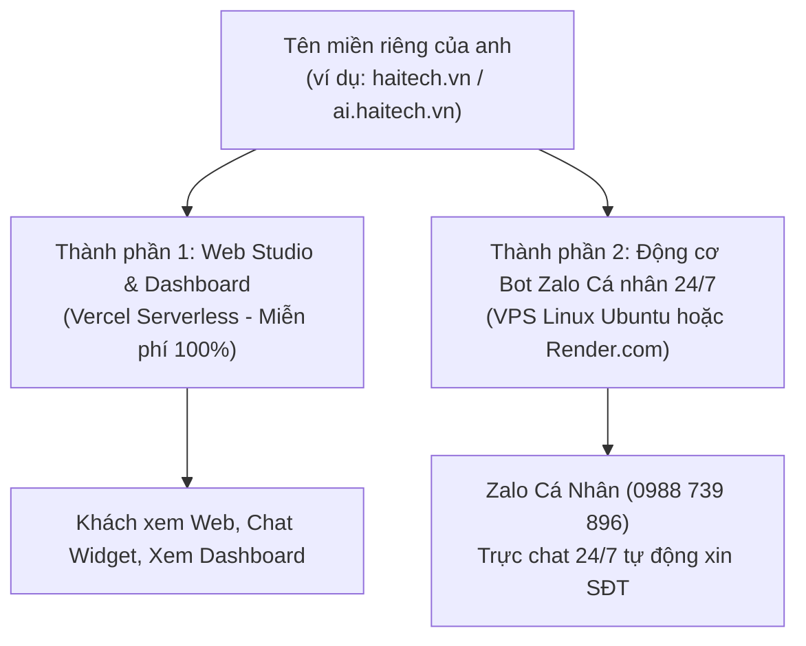
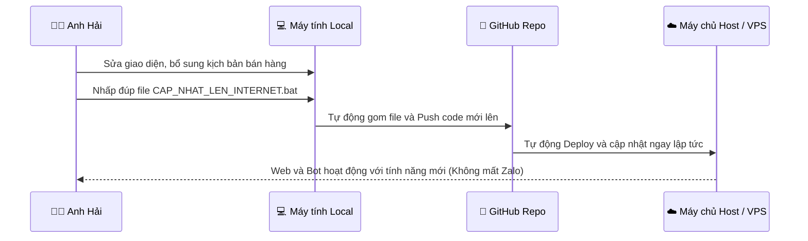

# 🌐 CẨM NANG HƯỚNG DẪN MUA TÊN MIỀN, THUÊ HOST RIÊNG & VẬN HÀNH 24/7

> **Tác giả:** HAITECH AI (Nguyễn Văn Hải — Hotline/Zalo: 0988 739 896)  
> **Dự án:** HAITECH BOT — Hệ thống Trợ lý AI Đa Kênh & Bot Zalo Cá Nhân 24/7  
> **Mục tiêu tài liệu:** Cung cấp hướng dẫn từng bước (Step-by-Step) giúp anh Hải tự gắn tên miền riêng thương hiệu cá nhân, thuê VPS/Host riêng chuẩn kỹ thuật và quy trình sửa đổi code an toàn tuyệt đối không làm gián đoạn hệ thống.

---

## 📌 PHẦN 1: BẢN CHẤT KIẾN TRÚC HỆ THỐNG (HIỂU ĐỂ MUA ĐÚNG HOST)

Hệ thống HaiTech Bot của anh gồm **2 thành phần độc lập kết hợp với nhau**:



| Thành phần | Đặc tính kỹ thuật | Nơi lưu trữ tối ưu | Chi phí |
| :--- | :--- | :--- | :--- |
| **1. Web Studio & Dashboard** (`index.html`, `dashboard.html`, `api/`) | Web tĩnh + Serverless Webhook | **Vercel Cloud** *(Đã triển khai sẵn)* | **Miễn phí 100% trọn đời** |
| **2. Động cơ Bot Zalo Cá nhân** (`bot-zalo-personal.js`) | Cần kết nối WebSocket liên tục 24/24 | **VPS Linux (Ubuntu)** hoặc **Render.com** | 50.000đ – 80.000đ/tháng (hoặc Miễn phí) |

> ⚠️ **CẢNH BÁO SỐNG CÒN KHI MUA HOST:**  
> **TUYỆT ĐỐI KHÔNG MUA** gói *Shared Web Hosting cPanel* thông thường (loại host người ta hay bán kèm để chạy web WordPress bằng PHP).  
> Loại host cPanel này **không thể chạy tiến trình WebSocket ngầm của Node.js**, mua về sẽ không chạy được Bot Zalo.  
> 👉 **BẮT BUỘC PHẢI CHỌN:** Gói **VPS (Máy chủ ảo chạy Linux Ubuntu 22.04 hoặc 24.04)** hoặc dùng **Render.com Cloud Web Service**.

---

## 🛒 PHẦN 2: HƯỚNG DẪN MUA TÊN MIỀN & VPS CHUẨN

### 1. Mua Tên Miền Riêng (Domain)
Anh có thể chọn các đuôi tên miền uy tín như `.vn`, `.com.vn`, `.com`, `.ai`, `.pro`:
- **Gợi ý tên miền đẹp:** `haitech.vn`, `haitechai.vn`, `haitechbot.vn`, `trolythuy linh.vn`...
- **Nhà cung cấp uy tín tại Việt Nam:** [Mắt Bão](https://matbao.net), [PA Việt Nam](https://pavietnam.vn), [Inet](https://inet.vn), [TinoHost](https://tinohost.com).
- **Nhà cung cấp quốc tế (Rất rẻ & quản lý DNS siêu tốc):** [Cloudflare](https://cloudflare.com), [Namecheap](https://namecheap.com).

### 2. Thuê VPS Linux Riêng (Nếu muốn tự làm chủ 100% máy chủ)
- **Cấu hình tối thiểu để chạy mượt:** 1 Core CPU, 1GB – 2GB RAM, 20GB SSD, Hệ điều hành: **Ubuntu 22.04 LTS (hoặc 24.04 LTS)**.
- **Nhà cung cấp VPS Việt Nam giá rẻ và đường truyền Zalo cực nhanh:**
  - **Vietnix:** Gói VPS giá rẻ ~60.000đ – 89.000đ/tháng.
  - **TinoHost:** Gói VPS Linux ~75.000đ/tháng.
  - **CloudFly / BKNS / AZDIGI:** Đều có gói VPS mini dưới 100.000đ/tháng.

---

## 🔀 PHẦN 3: HƯỚNG DẪN TRỎ TÊN MIỀN (DNS MAPPING) TỪNG BƯỚC

Sau khi mua tên miền, anh đăng nhập vào trang quản lý DNS của nhà cung cấp tên miền và thêm các bản ghi sau:

### Bước 1: Trỏ Website Studio & Trang Dashboard về Vercel
1. Đăng nhập vào [Vercel.com](https://vercel.com) -> Mở dự án `bot-zalo-ai`.
2. Vào tab **Settings** -> Mục **Domains**.
3. Nhập tên miền của anh:
   - Dùng tên miền chính: `haitech.vn`
   - Hoặc tên miền phụ: `ai.haitech.vn`
4. Trên trang quản lý DNS tên miền, thêm bản ghi:
   - **Loại (Type):** `CNAME`
   - **Tên (Host/Name):** `ai` (hoặc `www`)
   - **Giá trị (Value/Target):** `cname.vercel-dns.com`
   - **TTL:** `Auto` (hoặc `300`)
5. *Vercel sẽ tự động cấp chứng chỉ bảo mật xanh HTTPS (SSL) miễn phí 100% trong vòng 1-2 phút.*

### Bước 2: Trỏ Tên miền về Động cơ Bot Zalo 24/7

#### Lựa chọn 1: Nếu anh chạy trên Render.com (Khuyên dùng — Không cần quản trị máy chủ)
1. Trên Render.com -> Mở Web Service -> **Settings** -> **Custom Domains**.
2. Thêm domain: `bot.haitech.vn`.
3. Trong DNS tên miền, thêm bản ghi:
   - **Loại (Type):** `CNAME`
   - **Tên (Host/Name):** `bot`
   - **Giá trị (Value):** `haitech-zalo-bot.onrender.com` (theo Render cung cấp).

#### Lựa chọn 2: Nếu anh chạy trên VPS riêng (Chuyên nghiệp)
1. Lấy địa chỉ **IP Public** của VPS do nhà cung cấp cấp cho anh (Ví dụ: `103.123.45.67`).
2. Trong DNS tên miền, thêm bản ghi:
   - **Loại (Type):** `A`
   - **Tên (Host/Name):** `bot`
   - **Giá trị (Value):** `103.123.45.67` (Địa chỉ IP của VPS).

---

## 💻 PHẦN 4: HƯỚNG DẪN CÀI ĐẶT BOT LÊN VPS LINUX RIÊNG (TỪ A ĐẾN Z)

Nếu anh mua VPS Linux, chỉ cần thực hiện 4 bước sau bằng phần mềm **MobaXterm** hoặc **PuTTY**:

### 1. Đăng nhập vào VPS qua SSH:
```bash
ssh root@<IP_VPS_CỦA_ANH>
```

### 2. Cài đặt Node.js 20 và trình quản lý tiến trình PM2:
```bash
curl -fsSL https://deb.nodesource.com/setup_20.x | sudo -E bash -
sudo apt-get install -y nodejs git
sudo npm install -g pm2
```

### 3. Tải mã nguồn Bot về VPS:
```bash
git clone https://github.com/vanhaitech86-lab/bot-zalo-ai.git
cd bot-zalo-ai
npm install
```

### 4. Khởi chạy Bot vĩnh viễn 24/7 với PM2:
```bash
pm2 start bot-zalo-personal.js --name "thuy-linh" -- --force-active
pm2 startup
pm2 save
```

> ✅ **XONG!** Từ thời điểm này, Em Thùy Linh sẽ chạy vĩnh viễn trên VPS. Dù VPS có bị khởi động lại do sự cố điện thì PM2 cũng sẽ tự động bật lại Bot mà **KHÔNG CẦN QUÉT LẠI MÃ QR**!

---

## 🔄 PHẦN 5: "MỖI LẦN TÔI CHỈNH SỬA CÓ ẢNH HƯỞNG GÌ KHÔNG?"

👉 **TRẢ LỜI: HOÀN TOÀN AN TOÀN VÀ KHÔNG LÀM MẤT PHIÊN ĐĂNG NHẬP ZALO!**

### 1. Sửa trên máy tính cá nhân:
- Mọi chỉnh sửa code, file HTML, CSS hay `.bat` trên máy tính cá nhân của anh là hoàn toàn **nằm trong phạm vi nội bộ (Local)**.
- Trong lúc anh đang sửa và thử nghiệm, bot và website trên Internet vẫn đang trực tuyến 24/24 phục vụ khách hàng bình thường, không hề bị ảnh hưởng dù chỉ 1 giây.

### 2. Sửa kịch bản tư vấn bán hàng trong `knowledge.json`:
- Trong file `bot-zalo-personal.js`, em đã lập trình cơ chế đọc tri thức động (`loadKnowledge()`).
- Bất cứ khi nào anh bổ sung sản phẩm mới, đổi bảng giá hay thêm từ khóa, câu hỏi tiếp theo của khách gửi đến là bot đã tự động cập nhật ngay tri thức mới mà **không cần tắt bot hay ngắt kết nối**.

### 3. Có bị mất phiên Zalo hay bắt quét lại mã QR không?
- 👉 **TUYỆT ĐỐI KHÔNG!**
- Chuỗi đăng nhập Zalo được lưu độc lập trong file [`session.json`](file:///e:/BOT%20ZALO%20CH%C4%82M%20S%C3%93C%20KH%C3%81CH%20%20T%E1%BB%B0%20%C4%90%E1%BB%98NG/session.json) (và biến môi trường `ZALO_SESSION_JSON`).
- Khi anh cập nhật tính năng mới và khởi động lại, bot chỉ mất đúng **1.2 giây** để đọc lại phiên cũ và đăng nhập thẳng vào Zalo mà **không cần cầm điện thoại quét lại QR**.

---

## ⚡ PHẦN 6: QUY TRÌNH CẬP NHẬT 1 CHẠM KHI ANH SỬA CODE

Để anh không bao giờ phải gõ lệnh kỹ thuật phức tạp, em đã tạo sẵn file:  
👉 [`CAP_NHAT_LEN_INTERNET.bat`](file:///e:/BOT%20ZALO%20CH%C4%82M%20S%C3%93C%20KH%C3%81CH%20%20T%E1%BB%B0%20%C4%90%E1%BB%98NG/CAP_NHAT_LEN_INTERNET.bat)



**Cách làm cực kỳ đơn giản:**
1. Anh sửa code, sửa giao diện hoặc bổ sung tri thức trên máy tính xong.
2. Nhấp đúp chuột vào file [`CAP_NHAT_LEN_INTERNET.bat`](file:///e:/BOT%20ZALO%20CH%C4%82M%20S%C3%93C%20KH%C3%81CH%20%20T%E1%BB%B0%20%C4%90%E1%BB%98NG/CAP_NHAT_LEN_INTERNET.bat).
3. Nhập 1 dòng ghi chú (hoặc ấn Enter).
4. Hệ thống sẽ tự động đồng bộ lên GitHub và máy chủ Internet sẽ tự nhận code mới chỉ sau 30 giây!

---

## 🛠️ BẢNG TỔNG KẾT BỘ CÔNG CỤ QUẢN TRỊ TOÀN NĂNG

| Tên File | Chức năng chính |
| :--- | :--- |
| [`CAP_NHAT_LEN_INTERNET.bat`](file:///e:/BOT%20ZALO%20CH%C4%82M%20S%C3%93C%20KH%C3%81CH%20%20T%E1%BB%B0%20%C4%90%E1%BB%98NG/CAP_NHAT_LEN_INTERNET.bat) | 🚀 **1 CHẠM ĐỒNG BỘ:** Đẩy toàn bộ thay đổi lên Host Internet tự động. |
| [`XUAT_CHUOI_SESSION_LEN_CLOUD.bat`](file:///e:/BOT%20ZALO%20CH%C4%82M%20S%C3%93C%20KH%C3%81CH%20%20T%E1%BB%B0%20%C4%90%E1%BB%98NG/XUAT_CHUOI_SESSION_LEN_CLOUD.bat) | 🔑 Xuất chuỗi đăng nhập Zalo để dán lên Render.com hoặc VPS. |
| [`KIEM_TRA_TRANG_THAI_BOT.bat`](file:///e:/BOT%20ZALO%20CH%C4%82M%20S%C3%93C%20KH%C3%81CH%20%20T%E1%BB%B0%20%C4%90%E1%BB%98NG/KIEM_TRA_TRANG_THAI_BOT.bat) | 📊 Bảng điều khiển kiểm tra tiến trình, RAM, Bật/Tắt, xem danh sách khách. |
| [`CHAY_AN_247_KHONG_LO_TAT.vbs`](file:///e:/BOT%20ZALO%20CH%C4%82M%20S%C3%93C%20KH%C3%81CH%20%20T%E1%BB%B0%20%C4%90%E1%BB%98NG/CHAY_AN_247_KHONG_LO_TAT.vbs) | 🌸 Chạy bot ẩn trong nền máy tính Windows, không hiện cửa sổ đen CMD. |
| [`BAT_THUY_LINH.bat`](file:///e:/BOT%20ZALO%20CH%C4%82M%20S%C3%93C%20KH%C3%81CH%20%20T%E1%BB%B0%20%C4%90%E1%BB%98NG/BAT_THUY_LINH.bat) | 🟢 Bật bot với cửa sổ console và vòng lặp tự phục hồi 24/7. |
| [`DUNG_BOT_HOAN_TOAN.bat`](file:///e:/BOT%20ZALO%20CH%C4%82M%20S%C3%93C%20KH%C3%81CH%20%20T%E1%BB%B0%20%C4%90%E1%BB%98NG/DUNG_BOT_HOAN_TOAN.bat) | 🛑 Tắt sạch sẽ toàn bộ tiến trình bot đang chạy ngầm khi muốn dừng. |

---

*Chúc anh Nguyễn Văn Hải vận hành thành công và bùng nổ doanh số cùng Hệ thống Trợ lý HaiTech AI!*
